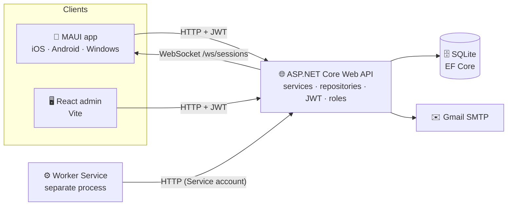

<div align="center">

# 🏋️ SportClub

**Group training schedule & booking system for a sports club**

Clients book group trainings with a monthly pass. Every training has a limited number of spots — when it is full,
the client joins a waitlist and is moved to a freed spot automatically.


</div>

---

## 📑 Contents

- [Features](#-features)
- [Architecture](#-architecture)
- [Tech stack](#-tech-stack)
- [Project structure](#-project-structure)
- [Getting started](#-getting-started)
- [Demo accounts](#-demo-accounts)
- [Business rules](#-business-rules)
- [Email notifications](#-email-notifications)
- [Payment](#-payment)
- [Running on an iPhone](#-running-on-an-iphone)
- [API](#-api)
- [Real-time updates](#-real-time-updates)
- [Background worker](#-background-worker)
- [Tests](#-tests)

---

## ✨ Features

| 👤 Client (mobile app) | 🧑‍🏫 Trainer (mobile app) | 🛠️ Admin (web) |
|---|---|---|
| Weekly schedule with filters by training type | Own trainings, upcoming and past | Trainers, training types, schedule, pass plans (CRUD) |
| Book a spot / join the waitlist | Participant list | Bookings with search, filter, sort and paging |
| Cancel a booking or leave the waitlist | Mark attendance (present / absent) | Monthly passes and users |
| Buy a monthly pass with a card form | Highlight for trainings with unmarked people | Most popular trainings statistics |
| Free spots update **live** | Own statistics | Light / dark theme, ET / EN |

**Also:** Estonian and English UI, light and dark theme, email notifications, simulated card payment,
automatic server discovery on the phone, and a separate background worker.

---

## 🏗️ Architecture



- Only the **Web API** talks to the database. Clients and the worker use the API over HTTP.
- Business logic lives in the **service layer** (`SportClub.Core`); controllers are thin.
- The **Worker** has no database access. It logs in with its own `Service` account and calls API endpoints.
- Errors are returned as **ProblemDetails** by one global exception handler.

---

## 🧰 Tech stack

| Layer | Technology |
|---|---|
| Backend | ASP.NET Core 10 Web API, EF Core (SQLite), Repository + Unit of Work, DI |
| Auth | JWT bearer tokens, roles `Admin`, `Trainer`, `Client`, `Service` |
| API docs | Swagger / OpenAPI with XML comments and examples, `SportClub.http` |
| Real-time | Native WebSockets (`/ws/sessions`) |
| Mobile | .NET MAUI, MVVM (CommunityToolkit.Mvvm), compiled bindings |
| Admin | React + Vite |
| Background | Worker Service (`BackgroundService` + `PeriodicTimer`, `HttpClient`) |
| Email | Gmail SMTP |
| Tests | xUnit + Moq |

---

## 📁 Project structure

```
SportClub/
├── SportClub.Api/             # Web API: controllers, JWT, Swagger, WebSocket, error handling
├── SportClub.Core/            # Entities, DTOs, services (business logic), repository interfaces
├── SportClub.Infrastructure/  # AppDbContext (SQLite), repositories, seed data
├── SportClub.Worker/          # Background worker: waitlist promotion + reminders
├── SportClub.Maui/            # Mobile app for clients and trainers (MVVM)
├── SportClub.Admin/           # React admin web UI
├── SportClub.Tests/           # Unit tests (xUnit + Moq)
├── start.bat / stop.bat       # Start / stop everything on Windows
└── SportClub.sln
```

---

## 🚀 Getting started

### Requirements

- [.NET 10 SDK](https://dotnet.microsoft.com/download) with the MAUI workload: `dotnet workload install maui`
- [Node.js](https://nodejs.org) (LTS) for the admin UI
- For iPhone: a Mac with Xcode

### Windows — one click

Run **`start.bat`**. It starts the API, the worker, the admin UI and the MAUI app, and opens Swagger and the admin in the browser.
**`stop.bat`** stops everything.

### Any OS — manually

Run each part in its own terminal, starting with the API:

```bash
# 1. API → http://localhost:5080/swagger   (database and demo data are created on first start)
dotnet run --project SportClub.Api --launch-profile lan

# 2. Worker
dotnet run --project SportClub.Worker

# 3. Admin UI → http://localhost:5173
cd SportClub.Admin
npm install
npm run dev

# 4. MAUI app
dotnet run --project SportClub.Maui -f net10.0-windows10.0.19041.0   # Windows
dotnet run --project SportClub.Maui -f net10.0-maccatalyst          # Mac
```

> **Note:** the database is created from the model on start. After changing entities, delete
> `SportClub.Api/sportclub.db*` and start the API again.

---

## 🔑 Demo accounts

| Role | E-mail | Password |
|---|---|---|
| Client | `klient@sportclub.ee` (also `karl@`, `anna@`, `peeter@`) | `Klient123!` |
| Trainer | `treener@sportclub.ee` (also `kertu@`, `liis@`, `rasmus@`) | `Treener123!` |
| Admin | `admin@sportclub.ee` | `Admin123!` |
| Service (worker) | `service@sportclub.ee` | `Service123!` |

---

## 📏 Business rules

- A booking needs an **active monthly pass** with visits left. One visit is used when booking and returned when cancelling.
- A client can have only **one active pass** at a time; a new pass is valid from today.
- A client's trainings must start **at least 3 hours apart**, so two trainings at the same time are not possible (`409`).
- Cancelling is allowed until **2 hours** before the start (Admin: always).
- Full training → `409`, and the client is added to the **waitlist** (the response contains the `position`).
- The worker promotes the first person in the queue every minute. People without a valid pass are removed from the queue.
  One hour before the start the whole queue is removed.
- Attendance can be marked from the start of the training. A trainer sees only their own trainings and statistics; Admin sees everything.

---

## ✉️ Email notifications

The API sends emails on **registration, booking, waitlist, promotion from the waitlist, the 1-hour reminder,
cancelled trainings and pass purchases** (receipt). Sending happens in the background — if it fails, it is only logged
and the booking still succeeds.

By default no email is sent, only logged. To send real emails through Gmail:

1. Turn on **2-Step Verification** on the Google account.
2. Create an **App password** at <https://myaccount.google.com/apppasswords>.
3. Copy `SportClub.Api/appsettings.Local.example.json` to `SportClub.Api/appsettings.Local.json` and fill it in:

   ```json
   {
     "Email": {
       "User": "your.name@gmail.com",
       "Password": "your16letterapppassword"
     }
   }
   ```

4. Restart the API.

> 🔒 `appsettings.Local.json` is in `.gitignore` — the password never goes to GitHub.

---

## 💳 Payment

Buying a monthly pass uses a **simulated** card payment — no money moves. The card number, expiry and CVC are checked
(Luhn algorithm, expiry date, CVC length) and then **discarded**. Only the card brand, the last 4 digits and a payment
reference are stored (e.g. `Visa •••• 4242`).

| Test card | Result |
|---|---|
| `4242 4242 4242 4242` | ✅ succeeds |
| `4000 0000 0000 0002` | ❌ declined (`402`) |

Any future expiry (e.g. `12/28`) and any 3-digit CVC work.

---

## 📱 Running on an iPhone

iOS apps are built on a Mac. The API can run on the Mac or on a Windows PC in the same Wi-Fi network —
**the app finds the server by itself** (it scans the local network for `/api/ping`).

1. On the Mac install Xcode, the .NET 10 SDK and the MAUI workload.
2. In Xcode create an empty iOS app with your bundle id (e.g. `ee.yourname.sportclub`), select your Apple ID as
   *Personal Team* and run it once on the iPhone. This creates the signing certificate.
3. On the iPhone enable **Settings → Privacy & Security → Developer Mode**.
4. Find the iPhone's UDID: `xcrun xctrace list devices`.
5. Build and install:

   ```bash
   cd SportClub.Maui
   dotnet run -f net10.0-ios -p:RuntimeIdentifier=ios-arm64 \
     -p:ApplicationId=ee.yourname.sportclub -p:_DeviceName=<UDID>
   ```

   If the build says the Xcode version is not supported, add `-p:ValidateXcodeVersion=false`.

6. Start the API with `--launch-profile lan` (or `start.bat` on Windows) and allow local network access on the phone.

---

## 🌐 API

Full documentation with examples: **<http://localhost:5080/swagger>** (button **Authorize** for the JWT).
Ready-made requests: [`SportClub.Api/SportClub.http`](SportClub.Api/SportClub.http).

| Method | Endpoint | Who |
|---|---|---|
| POST | `/api/auth/register`, `/api/auth/login` | everyone |
| GET | `/api/sessions?from=&to=&type=` | everyone |
| GET | `/api/trainers`, `/api/trainers/{id}/sessions`, `/api/types`, `/api/pass-plans` | everyone |
| GET / POST | `/api/passes/my`, `/api/passes` | Client |
| POST | `/api/sessions/{id}/bookings` (full → `409` + waitlist) | Client |
| POST | `/api/sessions/{id}/waitlist` | Client |
| GET | `/api/bookings/my` | Client |
| DELETE | `/api/bookings/{id}` (booking or waitlist place) | Client, Admin |
| GET | `/api/trainer/sessions` | Trainer |
| GET / PATCH | `/api/sessions/{id}/attendance` (whole list) | Trainer, Admin |
| PATCH | `/api/bookings/{id}/attendance` (one person) | Trainer, Admin |
| GET | `/api/stats/popular?from=&to=` | Trainer (own), Admin (all) |
| GET / POST / PUT / DELETE | `/api/trainers`, `/api/types`, `/api/sessions`, `/api/pass-plans` | Admin |
| GET | `/api/bookings?search=&status=&sort=&page=` | Admin |
| GET | `/api/passes?search=`, `/api/users?search=` | Admin |
| POST | `/api/waitlist/promote` | Service, Admin |
| GET | `/api/sessions/starting?within=60` | Service |
| POST | `/api/notifications` | Service |

Errors use the **ProblemDetails** format:

```json
{ "status": 409, "title": "Ajaline kattuvus", "detail": "Treeningute vahel peab olema vähemalt 3 tundi." }
```

---

## ⚡ Real-time updates

```
ws://localhost:5080/ws/sessions?access_token=<JWT>
```

All connected clients receive a message right after the data is saved, whenever the number of free spots changes:

```json
{ "type": "FreeSpotsChanged", "sessionId": 12, "free": 3 }
```

---

## ⚙️ Background worker

`SportClub.Worker` is a separate process (`BackgroundService` + `PeriodicTimer`). It logs in with the `Service`
account and only calls the API — the logic itself is in the API service layer.

| Job | Interval | Endpoint |
|---|---|---|
| Move the first person in the waitlist to a freed spot | every minute | `POST /api/waitlist/promote` |
| Remind clients 1 hour before the training | every 15 minutes | `GET /api/sessions/starting?within=60` → `POST /api/notifications` |

---

## 🧪 Tests

```bash
dotnet test
```

Unit tests for the booking, waitlist, monthly pass and payment services. Repositories and other dependencies are
replaced with **Moq** mocks.

---

<div align="center">

Made by **Adriana Pikaljov** · final project for *Programming* and *Distributed Applications*

</div>
